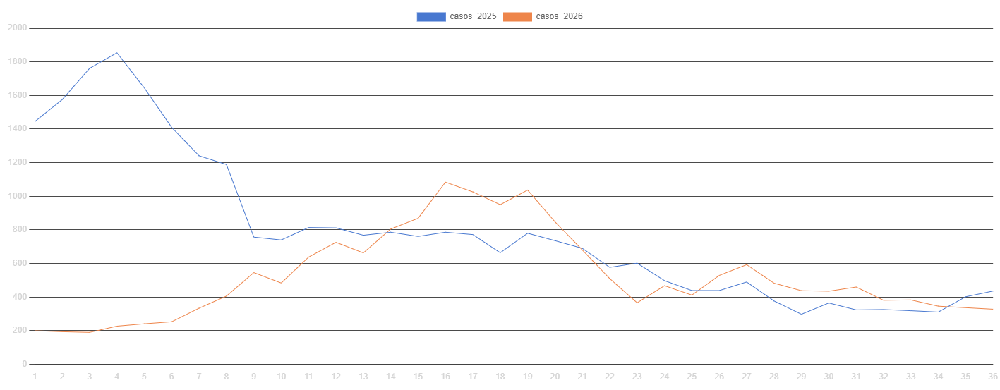
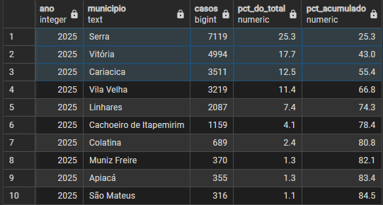
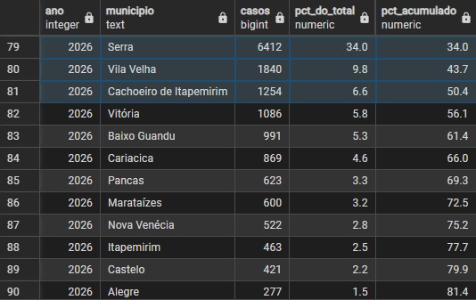
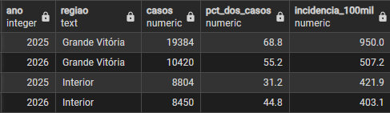
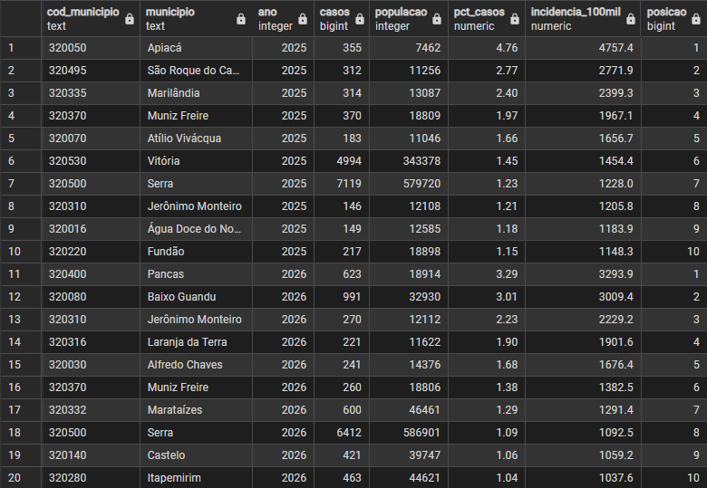
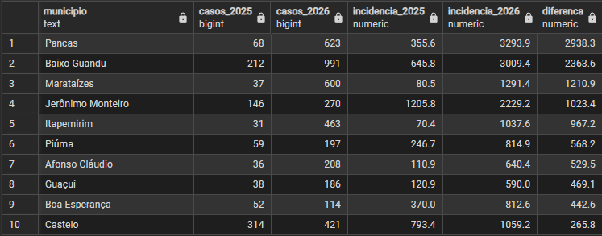
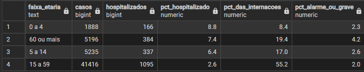
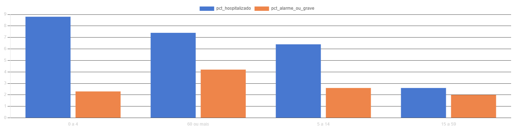
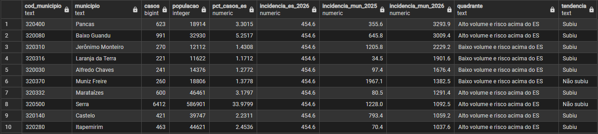
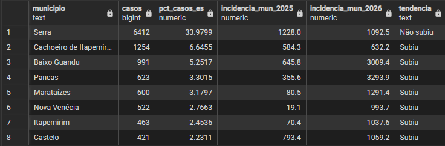

# Dengue no Espírito Santo: onde agir primeiro

## Contexto e objetivo
A dengue é de notificação compulsória, e a vigilância precisa decidir onde concentrar ações com recursos limitados. Neste projeto, analisei as notificações de 2025 e 2026 no Espírito Santo (SINAN) junto com a população do IBGE para entender quando, onde e em quem a doença pesa mais, e para propor uma priorização por município.

## Perguntas do projeto
1. Como a curva semanal de casos de 2026 se compara à de 2025?
2. Quais municípios concentram os casos e quais têm maior risco por habitante?
3. Onde o risco aumentou de 2025 para 2026?
4. Quais faixas etárias têm maior proporção de hospitalização e de casos com sinais de alarme ou graves?
5. Quais municípios priorizar, e com que tipo de ação?
6. Os dados são confiáveis o bastante para essas conclusões?

## Fontes de dados
| Fonte | Arquivo / Documento | Data de acesso | Link |
|---|---|---|---|
| Datasus dengue | DENGBR25.csv, DENGBR26.csv | 06/10/2026 | https://datasus.saude.gov.br/transferencia-de-arquivos/ |
| IBGE, estimativa 2025 | POP2025_20260828.xls | 06/10/2026 | https://www.ibge.gov.br/estatisticas/sociais/populacao/9103-estimativas-de-populacao.html |
| IBGE, estimativa 2026 | estimativa_dou_2026.xlsx | 06/10/2026 | mesma página |
| SINAN / Ministério da Saúde | Dicionário de Dados, Dengue | 06/10/2026 | https://portalsinan.saude.gov.br/images/documentos/Agravos/Dengue/DIC_DADOS_ONLINE.pdf |
| SINAN / Ministério da Saúde | Dicionário de Dados, Notificação Individual | 06/10/2026 | https://portalsinan.saude.gov.br/images/documentos/Agravos/Notificacao_Individual/DIC_DADOS_NET---Notificao-Individual_rev.pdf |

## Como reproduzir
1. Baixe os arquivos acima para a pasta `data/` (fora do repositório, pois são microdados).
2. Rode `01_tratamento.py`: lê o SINAN e o IBGE, filtra o ES e gera `data/dengue_es.csv` e `data/populacao_es.csv`.
3. Em um banco PostgreSQL, rode `sql/01_schema.sql` e importe os dois CSV em `dengue.casos` e `dengue.populacao` tratados.
4. Rode `sql/02_views.sql` (views) e `sql/03_consultas.sql` (conferências e análises).

## Modelo de dados
| Objeto | Tipo | Descrição |
|---|---|---|
| `dengue.casos` | tabela | Uma linha por notificação (ES, 2025 e 2026). Os microdados públicos não trazem identificador do caso, então não há chave única. |
| `dengue.populacao` | tabela | Chave primária composta (`cod_municipio`, `ano`): uma linha por município e ano, o que impede duplicidade e evita que o JOIN multiplique casos. |
| `dengue.vw_casos` | view | Casos com faixa etária e situação (aberto ou encerrado). |
| `dengue.vw_incidencia_municipio` | view | Casos e incidência por município e ano (SE 1 a 36), com ranking. Parte da população, para incluir municípios sem casos. |
| `dengue.vw_matriz_prioridade` | view | Classificação dos municípios por volume e risco em 2026. |

A ligação entre casos e população é feita pelo código de 6 dígitos do município (texto) e pelo ano.

## Tratamento e qualidade dos dados
- **Local:** município de residência (`SG_UF = 32`), pois a população do IBGE é de residentes.
- **Casos prováveis:** todas as notificações, exceto as descartadas, como no painel do Ministério da Saúde ([Dados Abertos SUS](https://dadosabertos.saude.gov.br/dataset/arboviroses-dengue)). Os arquivos não trazem descartados. Mantive os casos sem classificação ou inconclusivos porque, se saíssem, 2026 cairia de 67% para 58% de 2025 só porque os casos recentes ainda estão em investigação (17,5% sem classificação em 2026, contra 4,8% em 2025).
- **Ano e semana:** cada arquivo reúne os casos com primeiros sintomas no ano epidemiológico (semanas de domingo a sábado; a SE 1 é a que tem ao menos 4 dias de janeiro, segundo o [calendário do Sinan](https://portalsinan.saude.gov.br/calendario-epidemiologico)). Por isso o arquivo de 2025 vai de 29/12/2024 a 03/01/2026 em sintomas, e a análise usa a semana dos sintomas, e não a da notificação.
- **Comparação entre anos:** semanas 1 a 36. O arquivo de 2026 termina em 27/09/2026 (SE 38) e as semanas mais recentes ainda recebem casos. Então decidi filtrar ambos anos até a (SE 36), pelo padrão de 2025, cerca de 93% dos casos são notificados em até 15 dias e em 2026 88% em até 8 dias.
- **Incidência:** casos por 100 mil habitantes, com a população estimada do IBGE de cada ano, para comparar municípios de tamanhos diferentes.


| Problema | Como identifiquei | Tratamento |
|---|---|---|
| `DT_ENCERRA` com 8 espaços em branco no lugar de "sem data" | Contei os vazios antes e depois de converter para data | Espaços viram nulo; os 5.954 nulos batem com os casos abertos no SQL (1.461 + 4.493) |
| Códigos `0`, `8` e vazio fora do dicionário | Cruzei a classificação com a situação do caso (aberto ou encerrado) | `0` e vazio = "Não informado"; `8` = "Inconclusivo" |

```python
# 3) Ajustar tipos: datas, semana epidemiológica e idade em anos
for col in ["DT_NOTIFIC", "DT_SIN_PRI", "DT_ENCERRA"]:
    dengue[col] = dengue[col].str.strip().replace("", pd.NA)
    # aqui estou conferindo se há datas em ordem errada!
    datas_erradas = (~dengue[col].str.startswith("202", na=True)).sum()
    vazios_antes = dengue[col].isna().sum()
    dengue[col] = pd.to_datetime(dengue[col], format="%Y%m%d", errors="coerce")
    vazios_depois = dengue[col].isna().sum()
    print(col, "| vazios antes:", vazios_antes, "| vazios depois:", vazios_depois,
          "| datas erradas:", datas_erradas)
```


Dos 5.414 casos "Não informado", 5.215 (96%) estão abertos, ou seja, ainda sem classificação. Os 199 **encerrados** sem classificação contrariam o [dicionário](https://portalsinan.saude.gov.br/images/documentos/Agravos/Dengue/DIC_DADOS_ONLINE.pdf), que torna a classificação obrigatória quando há data de encerramento (campo 62). Os 143 "Inconclusivo" (código 8, descrito assim no dicionário de Notificação Individual) estão todos encerrados.

## Análises
As consultas completas estão em [`sql/03_consultas.sql`](sql/03_consultas.sql).

### 1. Quando? Curva semanal


Até a SE 36, 2026 soma 18.870 casos prováveis (67% dos 28.188 de 2025), e a incidência do ES caiu de 683,0 para 454,6 por 100 mil habitantes. O pico de 2025 foi na SE 4 (1.854 casos) e o de 2026 na SE 16 (1.084): 12 semanas depois e 42% menor.

**O que isso muda:** o momento de maior pressão variou muito entre os dois anos. Com dois anos não dá para afirmar sazonalidade, mas um calendário fixo de mobilização pode errar o momento; acompanhar a curva semanalmente é mais seguro.

### 2. Onde? Volume e risco
O volume mostra onde está a demanda por atendimento; a incidência mostra onde o morador está mais exposto.

```sql
SELECT 	ano, municipio, casos,
		ROUND(100.0 * casos / SUM(casos) OVER (PARTITION BY ano), 1) AS pct_do_total,
		ROUND(100.0 * SUM(casos) OVER (PARTITION BY ano ORDER BY ano, casos DESC)
			/ SUM(casos) OVER (PARTITION BY ano), 1) AS pct_acumulado
FROM dengue.vw_incidencia_municipio
GROUP BY ano, municipio, casos
ORDER BY ano, casos desc;
```



- **Volume:** em 2025, Serra, Vitória e Cariacica concentraram 55% dos casos; em 2026, Serra (34%), Vila Velha e Cachoeiro de Itapemirim somam 50%. Foram 7 municípios para chegar a 80% dos casos em 2025 e 12 em 2026: os casos ficaram mais espalhados.
- **Região:** a Grande Vitória teve 69% dos casos em 2025 e 55% em 2026, com 49% da população. Sua incidência caiu 47% (950,0 para 507,2), enquanto a do interior ficou praticamente igual (421,9 para 403,1).



- **Risco:** os maiores valores estão em municípios pequenos. Apiacá teve 4.757 casos por 100 mil em 2025, e Pancas, 3.294 em 2026 (7 vezes a incidência do estado, com 623 casos).



**O que isso muda:** a queda de 33% do estado veio quase toda da Grande Vitória, e a média estadual esconde que o interior continua com a mesma incidência. Volume pede capacidade de atendimento nos grandes municípios; incidência alta em município pequeno pede apoio regional.

### 3. Piorou? Onde o risco aumentou
Municípios com pelo menos 30 casos nos dois anos.

```sql
SELECT 
	a.municipio, a.casos AS casos_2025, 
	b.casos AS casos_2026, a.incidencia_100mil AS incidencia_2025, 
	b.incidencia_100mil AS incidencia_2026,
	ROUND(b.incidencia_100mil - a.incidencia_100mil, 1) AS diferenca
FROM dengue.vw_incidencia_municipio AS a
JOIN dengue.vw_incidencia_municipio AS b
	ON b.cod_municipio = a.cod_municipio
	AND b.ano = 2026
WHERE a.ano = 2025
  AND a.casos >= 30 AND b.casos >= 30
ORDER BY diferenca DESC
LIMIT 10;
```



Pancas (355,6 para 3.293,9), Baixo Guandu (645,8 para 3.009,4), Marataízes (80,5 para 1.291,4), Jerônimo Monteiro (1205.8 para 2229.2) e Itapemirim (70,4 para 1.037,6) tiveram os maiores aumentos. Só 3 dos 10 municípios de maior risco em 2025 seguem no top 10 de 2026: Muniz Freire, Serra e Jerônimo Monteiro.

**O que isso muda:** Em políticas públicas, é comum alocar verbas preventivas com base nos piores municípios do ano anterior. Esta análise prova que essa abordagem é ineficaz, pois surtos novos e explosivos (como Marataízes e Itapemirim) ficariam sem recurso.

### 4. Quem? Gravidade por faixa etária

```sql
SELECT faixa_etaria,
       COUNT(*) AS casos,
       SUM(CASE WHEN hospitalizado = 'Sim' THEN 1 ELSE 0 END) AS hospitalizados,
       ROUND(100.0 * SUM(CASE WHEN hospitalizado = 'Sim' THEN 1 ELSE 0 END) / COUNT(*), 1) AS pct_hospitalizado,
       ROUND(100.0 * SUM(CASE WHEN hospitalizado = 'Sim' THEN 1 ELSE 0 END)
             / SUM(SUM(CASE WHEN hospitalizado = 'Sim' THEN 1 ELSE 0 END)) OVER (), 1) AS pct_das_internacoes,
       ROUND(100.0 * SUM(CASE WHEN classificacao IN ('Dengue com sinais de alarme', 'Dengue grave')
                              THEN 1 ELSE 0 END) / COUNT(*), 1) AS pct_alarme_ou_grave
FROM dengue.vw_casos
GROUP BY faixa_etaria
ORDER BY pct_hospitalizado DESC;
```




Crianças de 0 a 4 anos têm a maior taxa de hospitalização (8,8%), e pessoas com 60 anos ou mais têm a maior proporção de casos com sinais de alarme ou graves (4,2%). Já os adultos de 15 a 59 anos, com a menor taxa (2,6%), respondem por 55% das 1.982 internações, porque são 77% dos casos.

**O que isso muda:** a orientação sobre sinais de alarme deve priorizar crianças pequenas e idosos (maior risco por caso), mas o dimensionamento de leitos precisa considerar os adultos (maior volume).

### 5. Onde agir primeiro? Matriz de volume e risco (2026)
Regras definidas neste projeto: municípios com menos de 30 casos não são classificados; **alto volume** é ter pelo menos 2% dos casos do ES (cerca de 377); **risco acima do ES** é incidência maior que a do estado (454,6).

| Quadrante | Municípios |
|---|---|
| Alto volume e risco acima do ES | 8 |
| Alto volume, risco na média ou abaixo | 3 (Vila Velha, Vitória e Cariacica) |
| Baixo volume e risco acima do ES | 12 |
| Baixo volume, risco na média ou abaixo | 17 |
| Poucos casos (não classificado) | 38 |

```sql
WITH es AS (
    SELECT ano,
		   SUM(populacao) AS populacao_es,
           SUM(casos) AS casos_es,
           ROUND(SUM(casos) * 100000.0 / SUM(populacao), 1) AS incidencia_es
    FROM dengue.vw_incidencia_municipio
    GROUP BY ano
),
base AS (
    SELECT m.cod_municipio, m.municipio, m.casos, m.populacao,
           ROUND(100.0 * m.casos / e.casos_es, 4) AS pct_casos_es,
           e.incidencia_es AS incidencia_es_2026,
           a.incidencia_100mil AS incidencia_mun_2025,
		   m.incidencia_100mil AS incidencia_mun_2026
    FROM dengue.vw_incidencia_municipio AS m
    JOIN es AS e
	ON e.ano = m.ano
    JOIN dengue.vw_incidencia_municipio AS a
      ON a.cod_municipio = m.cod_municipio 
	  AND a.ano = 2025
    WHERE m.ano = 2026
)
SELECT *,
       CASE WHEN casos < 30 THEN 'Poucos casos (não classificado)'
            WHEN pct_casos_es >= 2 AND incidencia_mun_2026 > incidencia_es_2026 THEN 'Alto volume e risco acima do ES'
            WHEN pct_casos_es >= 2 THEN 'Alto volume, risco na média ou abaixo'
            WHEN incidencia_mun_2026 > incidencia_es_2026 THEN 'Baixo volume e risco acima do ES'
            ELSE 'Baixo volume, risco na média ou abaixo' END AS quadrante,
       CASE WHEN incidencia_mun_2026 > incidencia_mun_2025 THEN 'Subiu' ELSE 'Não subiu' END AS tendencia
FROM base
ORDER BY incidencia_mun_2026 DESC;
```





Dos 8 municípios de prioridade máxima, 7 tiveram aumento de incidência. Apenas a Serra, que possui o maior volume absoluto (34% dos casos do estado), conseguiu reduzir sua incidência em relação a 2025.

## Conclusões e recomendações
1. **Reforçar vigilância e resposta em 7 municípios:** Cachoeiro de Itapemirim, Baixo Guandu, Pancas, Marataízes, Nova Venécia, Itapemirim e Castelo têm alto volume e incidência acima do estado e em alta. Em Marataízes, Nova Venécia e Itapemirim a incidência passou de menos de 100 para quase mil ou mais: vale investigar foco local.
2. **Manter a capacidade de atendimento na Serra e na Grande Vitória:** a Serra teve 34% dos casos de 2026, com incidência 2,4 vezes a do estado (menor que a de 2025).
3. **Apoio regional aos municípios pequenos de risco alto:** são 12 (como Jerônimo Monteiro, Laranja da Terra, Alfredo Chaves e Muniz Freire), com poucos casos mas incidência de até cerca de 5 vezes a do estado.
4. **Comunicação e leitos:** orientar sobre sinais de alarme para crianças de 0 a 4 anos e idosos, mas dimensionar os leitos pensando nos adultos de 15 a 59 anos (55% das internações).
5. **Acompanhar semanalmente, sem calendário nem lista fixos:** o pico mudou da SE 4 para a SE 16, e só 3 dos 10 municípios de maior risco repetem de um ano para o outro.
6. **Encerrar os casos abertos:** 3.188 casos estão abertos há mais de 60 dias, que é o [prazo de encerramento](https://dadosabertos.saude.gov.br/dataset/arboviroses-dengue) (1.461 de 2025 e 1.727 de 2026), e 10% das notificações estão sem classificação.

Os dados não mostram as causas das diferenças (clima, vetor, imunidade), o custo das ações nem a capacidade hospitalar. Os cortes de 30 casos e de 2% do total são escolhas deste projeto.

## Próximos Passos
Como este projeto foi delimitado aos anos de 2025 e 2026, as variações de pico demonstraram que dois anos não são suficientes para isolar a sazonalidade e afirmar padrões fixos no Espírito Santo. Como evolução técnica desta análise, os próximos passos seriam:

1. **Análise de Séries Temporais:** Ampliar a extração do SINAN para mais anos.
2. **Modelagem Preditiva:** Aplicar modelos de previsão para entender a correlação temporal e prever as semanas de pico epidemiológico com maior exatidão, auxiliando o dimensionamento hospitalar com antecedência.
3. **Dados Climáticos:** Cruzar a série temporal com dados pluviométricos (chuva e temperatura), variáveis que têm forte relação com o aumento de casos de dengue.