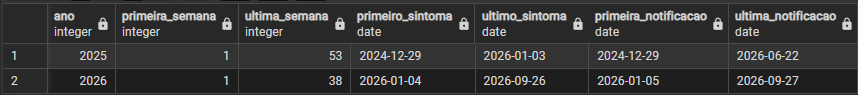
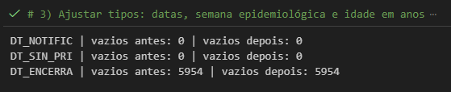
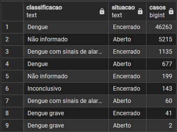

# Dengue no Espírito Santo: onde agir primeiro

## Objetivo
Diagnosticar como a dengue se distribuiu no Espírito Santo em 2025 e 2026 (quando, onde e em quem), separando os municípios com mais casos (volume) daqueles em que o risco por habitante é maior, para apoiar a priorização de ações de prevenção e de resposta.

## Perguntas de negócio
1. **Quando?** Como a curva semanal de 2026 se compara à de 2025?
2. **Onde?** Quais municípios concentram os casos (volume) e quais têm maior risco por habitante (incidência por 100 mil)?
3. **Repete?** Os municípios de maior risco são os mesmos nos dois anos?
4. **Quem?** Quais faixas etárias têm mais hospitalização e mais casos com sinais de alarme ou graves?
5. **Piorou?** Em quais municípios a incidência aumentou de 2025 para 2026, nas mesmas semanas?
6. **Confiável?** Qual a qualidade dos dados (casos sem classificação, abertos, tempo até o encerramento)?
7. **Onde agir?** Como classificar os municípios por volume e risco para orientar a priorização?

## Fontes de dados
| Fonte | Arquivo | Data do download | Link |
|---|---|---|---|
| Datasus dengue | DENGBR25.csv, DENGBR26.csv | 06/10/2026 | https://datasus.saude.gov.br/transferencia-de-arquivos/ |
| IBGE, estimativa 2025 | POP2025_20260828.xls | 06/10/2026 | https://www.ibge.gov.br/estatisticas/sociais/populacao/9103-estimativas-de-populacao.html |
| IBGE, estimativa 2026 | estimativa_dou_2026.xlsx | 06/10/2026 | mesma página |

## Estrutura
- data/: arquivos originais do SINAN e do IBGE e CSVs tratados (não versionados)
- 01_tratamento.py: leitura, filtro do ES e limpeza com pandas
- sql/: criação das tabelas (01_schema.sql), view (02_views.sql) e consultas de análise (03_consultas.sql), em PostgreSQL

## Decisões sobre os dados
- **Ano do caso = ano do arquivo do SINAN.** Os arquivos são organizados pelo ano
  epidemiológico dos primeiros sintomas (SEM_PRI): 100% das linhas de DENGBR25 têm
  SEM_PRI de 2025 e 100% das de DENGBR26 têm de 2026, então os arquivos não se sobrepõem.
  O arquivo de 2025 inclui notificações de 29-31/12/2024 e de 2026.
- **Local:** casos por município de **residência** (SG_UF = 32), pois a população do IBGE
  é de residentes.

## Conceitos usados

**Semana epidemiológica (SE).** As SE vão de domingo a sábado, e a SE 1 do ano é a que contém o maior número de dias de janeiro, ou seja, ao menos 4 dias do ano novo. Por isso a SE 1 de 2025 começou em 29/12/2024 e 2025 teve 53 semanas (a SE 53 terminou em 03/01/2026). A SE 1 de 2026 começou em 04/01/2026. Fonte: [calendário epidemiológico do Sinan, Ministério da Saúde](https://portalsinan.saude.gov.br/calendario-epidemiologico) ([2025](http://portalsinan.saude.gov.br/images/documentos/Calendario/2025.pdf) e [2026](http://portalsinan.saude.gov.br/images/documentos/Calendario/2026.pdf)).

**Qual data usar.** O arquivo de cada ano reúne os casos com primeiros sintomas naquele ano epidemiológico, e não as notificações feitas naquele ano. Por isso o arquivo de 2025 vai de 29/12/2024 a 03/01/2026 em **primeiros sintomas** (SE 1 a 53), mas tem notificações até 22/06/2026, porque alguns casos foram notificados meses depois. O arquivo de 2026 vai da SE 1 à SE 38 (sintomas de 04/01/2026 a 26/09/2026). As análises ao longo do tempo usam a **semana e a data dos primeiros sintomas** (`SEM_PRI`, `DT_SIN_PRI`). A consulta mostra o período coberto por cada ano:

```sql
SELECT ano,
       MIN(semana) AS primeira_semana, MAX(semana) AS ultima_semana,
       MIN(data_sintomas) AS primeiro_sintoma, MAX(data_sintomas) AS ultimo_sintoma,
       MIN(data_notificacao) AS primeira_notificacao, MAX(data_notificacao) AS ultima_notificacao
FROM dengue.casos
GROUP BY ano
ORDER BY ano;
```



**Comparação entre anos.** O arquivo de 2026 termina em 27/09/2026 (SE 38), e casos recentes ainda estão sendo notificados. Por precaução, as comparações entre 2025 e 2026 usam as **semanas 1 a 36** dos dois anos (a SE 36 de 2026 terminou em 12/09/2026).

**Incidência.** Número de casos novos em um período dividido pela população em risco no mesmo período ([UNA-SUS](https://ares.unasus.gov.br/acervo/bitstreams/b435a959-5f39-4d37-a918-37cdbb7baee1/download)). Casos notificados por 100 mil habitantes = casos ÷ população × 100.000, com a população estimada pelo IBGE no mesmo ano. É a incidência de **casos notificados**, e não de todas as infecções.

**Proporções entre os casos.** O percentual de hospitalizados por faixa etária é a proporção entre os casos **notificados**, e não o risco de hospitalização da população.

## Qualidade dos dados: o que encontrei e como tratei

| # | Problema | Como identifiquei | Tratamento |
|---|---|---|---|
| 1 | `DT_ENCERRA` com 8 espaços em branco no lugar de "sem data" | Contei os vazios antes e depois de converter para data: 0 antes e 5.954 depois | Espaços viram vazio (NULL); os 5.954 conferem com os casos abertos no SQL (1.461 + 4.493) |
| 2 | Códigos `0`, `8` e vazio em classificação, critério, evolução e hospitalização, fora do dicionário | Consulta SQL que cruza a classificação com a situação do caso (aberto ou encerrado) | `0` e vazio = "Não informado"; `8` = "Inconclusivo" (provável) |
| 3 | Arquivo de 2025 com notificações de 2024 e de 2026 | Período coberto por cada ano (seção "Qual data usar") | Ano do caso = ano epidemiológico dos primeiros sintomas |

### Datas de encerramento com espaços em branco
O SINAN grava oito espaços em branco quando o caso não tem data de encerramento. Como a conversão usa `errors="coerce"`, o resultado já saía NULL, e as consultas não mudaram. O tratamento (`.str.strip()`) deixa o log verificável: depois dele, os vazios antes e depois da conversão são iguais.



### Códigos 0, 8 e vazio
```sql
SELECT classificacao, situacao, COUNT(*) AS casos
FROM dengue.vw_casos
GROUP BY classificacao, situacao
ORDER BY casos DESC;
```



| Valor | Evidência | Decisão |
|---|---|---|
| `0` e vazio | 5.414 casos sem classificação, cerca de 96% abertos | "Não informado" |
| `8` | 143 casos, todos encerrados; o anexo do [dicionário do Sinan](http://portalsinan.saude.gov.br/images/documentos/Agravos/Notificacao_Individual/DIC_DADOS_NET---Notificao-Individual_rev.pdf) usa 8 para "Inconclusivo" em outros agravos | "Inconclusivo" (provável) |

"Não informado" (em branco ou `0`) é diferente de "Ignorado" (código 9, preenchido como ignorado).

### Limitações
- **Duplicidade:** o campo `NDUPLIC_N` está em 0 ou vazio em todos os registros (ninguém marcou duplicidade), e os arquivos públicos não trazem o número da notificação, então não há como checar duplicados de outra forma.
- **Notificação em lote:** 155 casos de Guarapari, com sintomas entre 21/02/2025 e 29/12/2025, foram registrados em 18 e 19/06/2026, todos sem classificação e abertos. Como usamos a data dos sintomas, eles entram na semana certa.
- **Casos notificados:** os números não incluem quem não procurou atendimento nem os casos não notificados.
- **Óbitos:** só 7 óbitos pelo agravo em dois anos (2 em 2025 e 5 em 2026), pouco para analisar letalidade.

## Modelo de dados (PostgreSQL, schema `dengue`)
| Objeto | Tipo | Chave / regra |
|---|---|---|
| `dengue.casos` | tabela | Uma linha por notificação (ES, 2025-2026). Sem chave única: o recorte dos microdados públicos não traz identificador do caso. |
| `dengue.populacao` | tabela | **Chave primária composta (cod_municipio, ano)**: uma só linha por município e ano. Impede duplicidade e evita que o JOIN multiplique casos. |
| `dengue.vw_casos` | view | Camada de análise: cria a faixa etária e a situação do caso (aberto ou encerrado) |

Relação: `casos (cod_municipio, ano)` com `populacao (cod_municipio, ano)`, usando o código de 6 dígitos do município (texto).

## Onde cada tratamento acontece
Cada coluna é tratada em um só lugar.
- **Python (pandas):** leitura, filtro do ES, tipos (datas, idade) e tradução de **todos** os códigos de cada coluna, inclusive os que o dicionário não descreve (`0`, `8` e vazio).
- **SQL (view):** colunas criadas para a análise (faixa etária e situação do caso) e os indicadores.